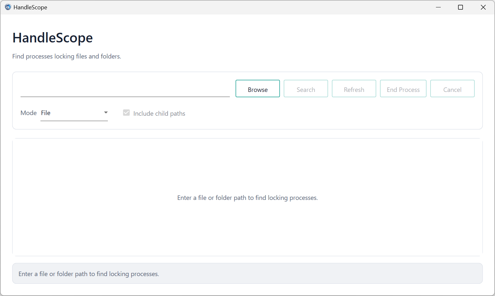

# HandleScope

Windows File Lock Detection Utility



HandleScope is a Windows desktop utility that identifies processes locking files and folders, helping users quickly discover why resources cannot be deleted, moved, renamed, or modified.

Built with WPF on .NET 9 using the MVVM pattern and powered by the Windows Restart Manager API.

## Features

* Find processes locking a selected file.
* Search for locks inside a folder, including child paths.
* View process details, including:

  * Process name
  * Process ID (PID)
  * User
  * Executable path
  * Locked path
* Refresh results without selecting the target again.
* Cancel long-running searches.
* End a selected process with confirmation.
* Log errors and diagnostic information.

## Technology Stack

* .NET 9
* WPF
* MVVM
* CommunityToolkit.Mvvm
* Windows Restart Manager API
* Serilog
* WiX Toolset

## How It Works

HandleScope uses the Windows Restart Manager API (`rstrtmgr.dll`) to identify processes associated with files currently in use.

For folder searches, the application registers files located inside the selected directory and queries Restart Manager for associated processes.

To keep searches predictable and responsive, folder scanning is limited to the first 512 files.

Because Restart Manager works with file resources, pure directory handles are not detected unless files inside the directory are involved.

## Requirements

### Development

* Windows 10 / Windows 11
* .NET 9 SDK
* Visual Studio 2022

### Runtime

* Windows operating system
* .NET 9 Desktop Runtime (for framework-dependent deployments)

## Build and Run

Build the solution:

```powershell
dotnet build .\HandleScope.sln
```

Run the application:

```powershell
dotnet run --project .\src\HandleScope\HandleScope.csproj
```

## MSI Installer

The installer project is located in:

```text
installer\HandleScope.Installer
```

Build the MSI installer:

```powershell
dotnet build .\installer\HandleScope.Installer\HandleScope.Installer.wixproj -c Release
```

The generated MSI package is created in:

```text
installer\HandleScope.Installer\bin\Release\HandleScopeSetup.msi
```

The installer:

* Installs the application into `Program Files\HandleScope`
* Creates Start Menu shortcuts
* Creates a Desktop shortcut
* Registers the application in Windows Programs and Features

## Project Structure

```text
src/
  HandleScope/                 WPF application and user interface
  HandleScope.Application/     Application service contracts
  HandleScope.Domain/          Domain models and shared contracts
  HandleScope.Infrastructure/  Restart Manager and process management services

installer/
  HandleScope.Installer/       WiX MSI installer project

docs/
  images/                      Screenshots and documentation assets
```

## Logging

Application logs are stored in:

```text
%LOCALAPPDATA%\HandleScope\Logs
```

## Note

Terminating processes may result in unsaved work being lost.

Always review process information carefully before ending a process.

## GitHub Description

Find and manage processes locking files and folders. Built with WPF, .NET 9, and Windows Restart Manager.
