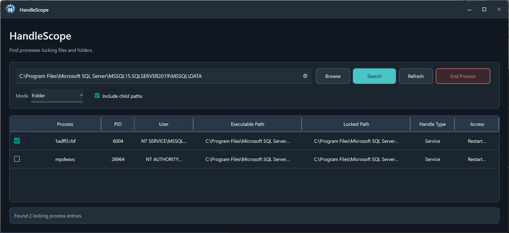
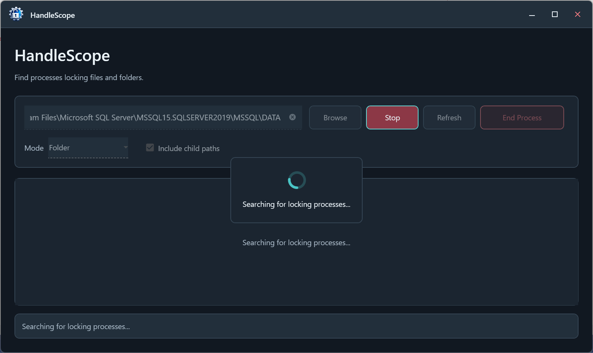
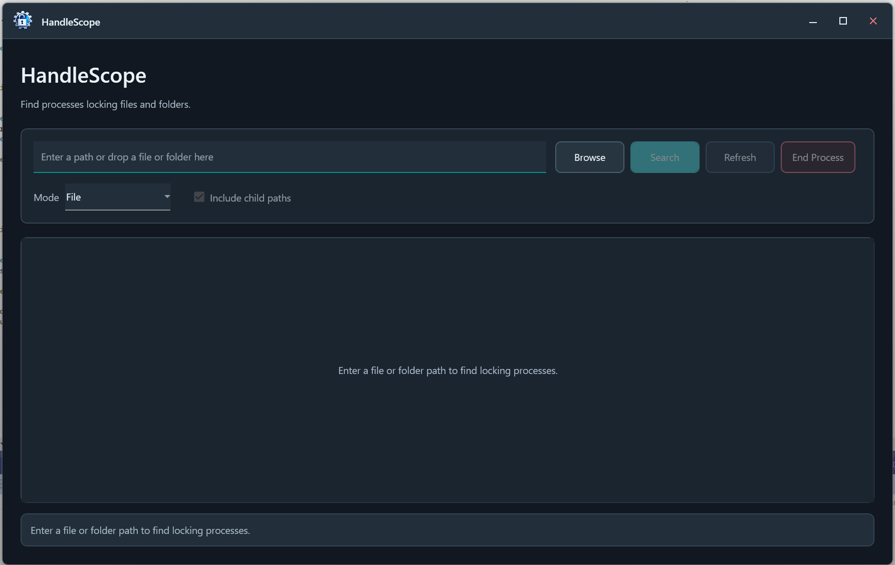

# HandleScope

**Find out which Windows processes are using a file or folder.**

HandleScope is a Windows desktop app for investigating files that cannot be moved, renamed, deleted, or modified because another process is using them. It uses the Windows Restart Manager API to find associated processes, shows their details, and can end a selected process after confirmation.

Built with WPF and .NET 9 using MVVM.

## Screenshots

### Locking processes found



### Search in progress



### Ready to search



## Features

* Find processes locking a selected file.
* Search for locks inside a folder, including child paths.
* Enter a path, browse, or drop a file or folder into the path field.
* View process details, including:

  * Process name
  * Process ID (PID)
  * User
  * Executable path
  * Locked path
* Refresh results without selecting the target again.
* Cancel long-running searches.
* End a selected process with confirmation and request administrator permission only when needed.
* Log errors and diagnostic information.

## Using HandleScope

1. Select **File** or **Folder**, then enter a path, use **Browse**, or drop one file or folder into the path field.
2. For folder searches, leave **Include child paths** selected to scan files in subfolders, or clear it to scan only files directly in the selected folder.
3. Select **Search** to find associated processes. Select **Stop** to cancel a search in progress.
4. Review the process details. To close one, check the box beside it and choose **End Process**. HandleScope asks for confirmation and may show a Windows administrator prompt if elevated rights are required.

## Technology Stack

* .NET 9
* WPF
* MVVM
* CommunityToolkit.Mvvm
* Windows Restart Manager API
* Serilog
* WiX Toolset

## How It Works

HandleScope uses the Windows Restart Manager API (`rstrtmgr.dll`) to identify processes associated with files currently in use.

For folder searches, the application registers files located inside the selected directory and queries Restart Manager for associated processes.

To keep searches predictable and responsive, folder scanning is limited to the first 512 files.

Because Restart Manager works with file resources, pure directory handles are not detected unless files inside the directory are involved.

## Requirements

### Development

* Windows 10 / Windows 11
* .NET 9 SDK
* Visual Studio 2022

### Runtime

* Windows 10 or Windows 11
* .NET 9 Desktop Runtime

## Build and Run

Build the solution:

```powershell
dotnet build .\HandleScope.sln
```

Run the application:

```powershell
dotnet run --project .\HandleScope\HandleScope.csproj
```

## MSI Installer

The installer project is located in:

```text
HandleScope.Installer
```

Build the MSI installer:

```powershell
dotnet build .\HandleScope.sln -c Debug -p:Platform=x86
dotnet build .\HandleScope.sln -c Debug -p:Platform=x64
dotnet build .\HandleScope.sln -c Release -p:Platform=x86
dotnet build .\HandleScope.sln -c Release -p:Platform=x64
```

The generated MSI package is created in:

```text
HandleScope.Installer\bin\Debug\x86\HandleScopeSetup.msi
HandleScope.Installer\bin\Debug\x64\HandleScopeSetup.msi
HandleScope.Installer\bin\Release\x86\HandleScopeSetup.msi
HandleScope.Installer\bin\Release\x64\HandleScopeSetup.msi
```

The installer:

* Installs the application into `Program Files\HandleScope` or `Program Files (x86)\HandleScope`, depending on the MSI architecture
* Creates Start Menu shortcuts
* Creates a Desktop shortcut
* Registers the application in Windows Programs and Features

## Project Structure

```text
HandleScope/                 WPF application and user interface
HandleScope.Services/        Service contracts, models, and Windows process services
HandleScope.Presentation/    Shared WPF resources and controls
HandleScope.Logger/          Logging configuration and constants
HandleScope.Installer/       WiX MSI installer project
HandleScope.Services.Tests/  Unit tests for service behavior
```

## Logging

When run from the repository, application logs are stored in:

```text
<solution root>\Logs
```

When installed, the app uses `Logs` next to `HandleScope.exe`. If that directory is not writable, it uses `%LOCALAPPDATA%\HandleScope\Logs`.

## Note

Terminating processes may result in unsaved work being lost.

Always review process information carefully before ending a process.

## GitHub repository description

Find Windows processes using your files and folders. Inspect locks and end selected processes with a WPF desktop app.

Suggested topics: `windows`, `wpf`, `dotnet`, `file-locks`, `restart-manager`, `wix`.
